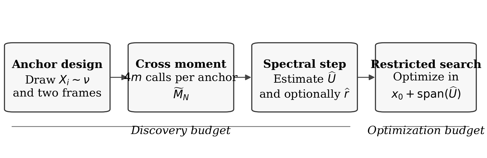
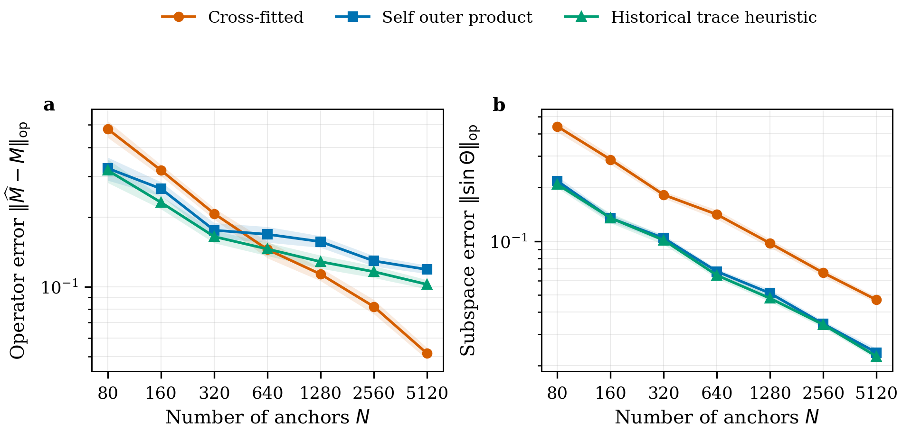
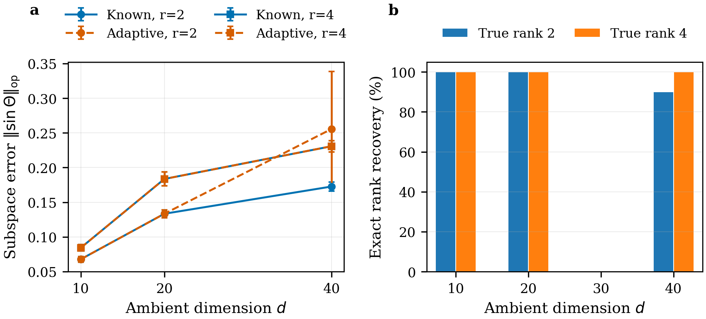
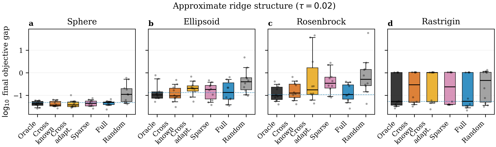
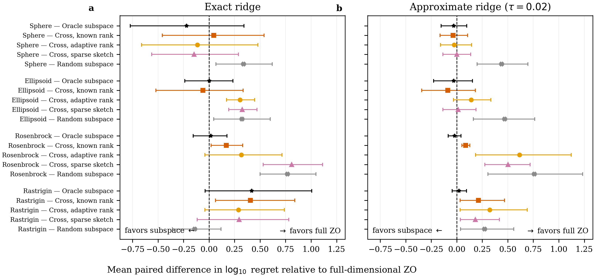
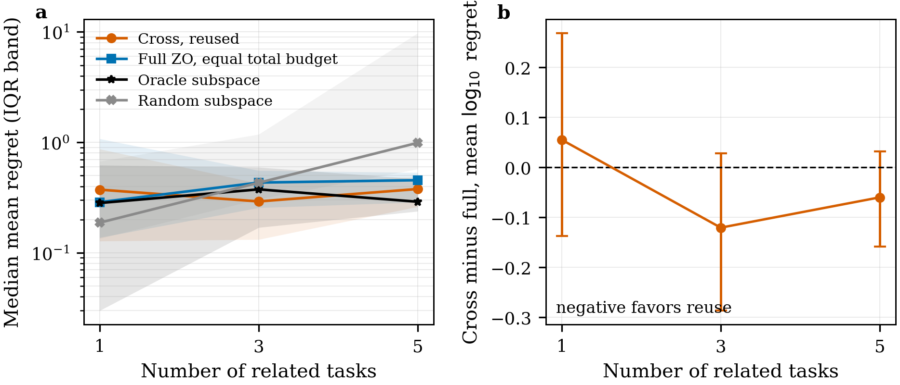

# Introduction {#sec-introduction}

A simulator may depend strongly on only a few combinations of its inputs, as in some airfoil parameter studies [@grey2018active]. Active-subspace analysis identifies those combinations from the leading eigenvectors of an average gradient outer product [@constantine2015active]. We study how accurately that matrix and its leading eigenspace can be estimated when the simulator returns only noisy scalar function values. This is a statistical estimation problem motivated by derivative-free, or zeroth-order (ZO), optimization.

Two function evaluations on either side of a sampled point give a centered finite difference along one direction. One could use fixed coordinate directions, which gives a deterministic approximation when evaluations are noiseless. We use random orthogonal directions and combine the differences into a vector estimate, called a *gradient sketch*. The matrix formed by multiplying this vector by its transpose includes the sketch's covariance. Even with exact directional derivatives, random projection changes the expected spectrum.

At each sampled point, or *anchor*, we form two independent sketches and average the symmetrized products between them. We call this construction cross-fitting. The mean sketch is the gradient of the ball-smoothed objective, which averages the function uniformly over a ball around the anchor. We establish three results.

1. **Population targets.** The raw cross-fitted estimator is unbiased for the smoothed gradient second moment under independent, mean-zero observation noise. For exact directional derivatives, we use the closed-form projection correction of Azizyan et al. [@azizyan2018extreme] and derive the additional adjustment for independent homoskedastic observation noise with known variance.
2. **Finite-sample recovery.** Under bounded sketches, matrix Bernstein and Davis--Kahan give operator-norm and principal-angle bounds for the cross-fitted estimator. We give a sufficient condition for rank recovery by spectral thresholding and a discovery lower bound for a rank-one family with Gaussian observations.
3. **Optimization after discovery.** For the convex setting in @thm-transfer, the error from restricting the search to an estimated subspace is bounded by its squared principal-angle error times a smoothness and distance factor. The numerical study charges for discovering the subspace and measures the objective value reached by a two-point optimizer, whose updates each use two perturbed evaluations.

The accompanying reproducibility package contains the study code, configurations, recorded outputs, and scripts for producing the figures and tables.

# Relation to existing approaches {#sec-related}

## Active subspaces with and without gradients

The active-subspace matrix is an uncentered gradient second moment [@constantine2015active]. Zahm et al. [@zahm2020gradient] relate Jacobian-based projections to function approximation for vector-valued outputs. Constantine et al. [@constantine2015sketching] estimate active subspaces from gradient sketches, including sketches obtained from directional derivatives. Here we use centered differences of noisy function values, and the object we estimate is the complete moment matrix. Its eigenvalues matter when estimating rank or measuring variation outside the leading subspace.

Constantine and Gleich [@constantine2014monte] analyze Monte Carlo outer products of exact gradients and extend their bounds to uniformly accurate approximate gradients. Holodnak et al. [@holodnak2018probabilistic] obtain an intrinsic-dimension bound for a positive-semidefinite Monte Carlo approximation. We use the same concentration and perturbation framework in @thm-concentration and @cor-subspace. The summands here are symmetric cross products that can be indefinite, with expectation $M_h$ given by @prp-unbiased. Their error bound is in terms of the size of the sketches, and comparison with the unsmoothed eigenspace includes a separate smoothing error.

## Orthogonal finite differences and smoothed moments

Feng and Wang [@feng2023stochastic] study the bias and variance of centered gradient estimates formed from random orthogonal directions. We use this same gradient construction. @prp-unbiased applies its exact mean under ball smoothing to a product of two independent estimates at the same point. This uses the elementary factorization of the expectation of a product of independent estimators. @prp-inflation and the subsequent correction address the alternative of using one orthogonal sketch per point.

Yuan et al. [@yuan2025smoothed] estimate an expected Gaussian-smoothed gradient outer product for multiple-index regression. They form independent gradient estimates using separate groups of regression observations and obtain a parametric $C_d n^{-1/2}$ rate. For polynomial links of degree at most $p$ under standard Gaussian design, they give $C_d$ proportional to $d^p$. Our setting permits queries at paired points around each chosen anchor, yielding a ball-smoothed target with a fixed number of evaluations per anchor.

The self-product formula and its inverse are known for compressed covariance estimation [@azizyan2018extreme, Proposition 1]. In @prp-inflation we identify the latent vector as the gradient at an anchor. The explicit correction in @sec-self-correction then accounts for the extra noise due to differencing two independent function values and specifies when finite differences give the exact linear sketch.

## Low-dimensional derivative-free optimization

Djolonga et al. [@djolonga2013high] learn a low-dimensional representation from function values for Gaussian-process optimization. Cartis et al. [@cartis2024learning] estimate a subspace of variation from sampled gradients and study global convergence of a sequence of reduced problems. Random embeddings and random-subspace methods reduce the dimension of individual searches or local models [@nayebi2019hesbo; @nozawa2024zeroth; @chen2024quadratic], and trajectory-informed methods exploit structure found during search [@golovin2020gradientless]. Our discovery stage estimates a single population eigenspace that can be reused across updates or related objectives.

ASTARS and FAASTARS already use active subspaces to accelerate noisy derivative-free optimization [@hall2021astars]. FAASTARS learns the subspace and optimizer hyperparameters, including noise information. We focus on the matrix used to learn the subspace from noisy values. @thm-transfer bounds the objective penalty of using an estimated affine search space under its convex feasibility assumptions. The two-point analysis uses standard zeroth-order updates [@duchi2015optimal; @nesterov2017random; @shamir2017optimal]. The experiments use a shared update rule to examine how choice of subspace and the cost of discovery affect the attained objective.

# Problem formulation {#sec-problem}

## Function-value oracle

Let $\mathcal X\subseteq \mathbb R^d$ be a compact convex search set. We assume $f$ and its oracle are defined at all perturbation points used below. The oracle returns

$$
Y(x)=f(x)+\xi,
$$

where $\mathbb E[\xi\mid x]=0$. Unless stated otherwise, each call uses a fresh noise draw conditional on its query location. The exact gradient defines the population target but is unavailable to the algorithm. For anchor distribution $\nu$, this target is

$$
M=\mathbb E_{X\sim\nu}
\left[\nabla f(X)\nabla f(X)^\top\right].
$$

The leading $r$-dimensional eigenspace of $M$ is denoted $U_\star\in\mathbb R^{d\times r}$. Write the ordered eigenvalues as

$$
\lambda_1\geq\cdots\geq\lambda_r
>\lambda_{r+1}\geq\cdots\geq0,
\qquad
\Delta_r=\lambda_r-\lambda_{r+1}.
$$

An exact ridge objective has the form

$$
f(x)=\phi(U_\star^\top(x-s)),
$$

where $s$ lets us translate benchmark instances while controlling the location of the minimizer. It can be absorbed into $\phi$ in the exact ridge model. For the approximate-ridge benchmarks we use

$$
f_\tau(x)=\phi(U_\star^\top(x-s))
+\frac{\tau}{2}\Vert(I-U_\star U_\star^\top)(x-s)\Vert_2^2,
$$

with $\tau\geq0$. The extra term penalizes a displacement orthogonal to the reference subspace, with strength $\tau$. Setting $\tau=0$ recovers the exact ridge. When $\tau>0$, the embedded subspace is known by construction and the ordering of the full gradient-moment eigenvalues depends on the objective and anchor law.

## Assumptions and scope

| Result | Principal assumptions | Conclusion |
|:---|:---|:---|
| @prp-unbiased | Ball-smoothing identity, independent uniform orthogonal frames, independent mean-zero noise | Raw cross moment targets the smoothed moment |
| @prp-inflation and @sec-self-correction | One uniform orthogonal frame and exact directional derivatives. The noisy correction also requires independent errors of known constant variance | Self-product population bias and its inverse |
| @thm-concentration | Independent anchors and sketch pairs, with almost surely bounded sketch norms | Operator-norm error for the raw cross moment |
| @cor-subspace | A positive eigengap, with matrix error at most half the gap | Principal-angle error |
| @prp-rank | Exact-rank target and a threshold between the noise and signal eigenvalues as specified in the proposition | Rank recovery by spectral thresholding |
| @thm-transfer | Convex smooth objective, stationary optimum, and a feasible projected representative | Objective error due to subspace restriction |
| @thm-lower | Rank-one quadratic family, Gaussian noise, queries in the unit ball | Lower bound on queries for direction estimation |

The Gaussian-noise benchmarks use unbounded sketches. Sphere and Ellipsoid illustrate convex objectives, and Rosenbrock and Rastrigin test the same numerical procedure on nonconvex objectives.

## What must be estimated

We measure three errors.

- **Matrix error.** We measure the operator-norm distance to $M$, or to its smoothed counterpart $M_h$ when stating estimation guarantees.
- **Subspace error.** We estimate the projector $P_\star=U_\star U_\star^\top$. For subspaces of the same dimension, the loss is
  $$
  \mathcal L_{\mathrm{sub}}(\widehat U,U_\star)
  =\Vert\sin\Theta(\widehat U,U_\star)\Vert_{\mathrm{op}}.
  $$
- **Optimization error.** We measure the objective gap after charging both discovery and optimization calls to the total budget.

# Cross-fitted orthogonal sketches {#sec-method}

## Centered directional differences

For a unit direction $u$, finite-difference radius $h>0$, and anchor $x$, define the standard centered difference [@berahas2019comparison]

$$
\delta_hY(x;u)=\frac{Y(x+hu)-Y(x-hu)}{2h}.
$$

Using fixed coordinate directions gives the usual coordinate-wise finite-difference gradient estimate. Here we sample a uniform orthogonal frame $Q=[q_1,\ldots,q_m]\in\mathbb R^{d\times m}$, with $1\leq m\leq d$, and form

$$
\widehat g_Q(x)
=\frac{d}{m}\sum_{j=1}^m\delta_hY(x;q_j)q_j.
$$

The factor $d/m$ corrects the mean projector because a uniformly random $m$-frame satisfies

$$
\mathbb E[QQ^\top]=\frac{m}{d}I_d.
$$

The sketch uses $2m$ evaluations. Orthogonality avoids nearly collinear probes within a batch. Feng and Wang [@feng2023stochastic] quantify the resulting variance reduction for gradient estimation.

Two independent batches per anchor give the following call count.

```{python}
#| eval: false
from discoverzo.subspace import CrossMomentEstimator

estimator = CrossMomentEstimator(
    h=0.03,
    anchor_radius=1.0,
    directions_per_side=12,
    psd_projection=True,
)
result = estimator.estimate(oracle, d=12, n_anchors=15, rng=rng)
print(result.query_count)  # 4 * 12 * 15 = 720
```

## Cross-fitting

At anchor $X_i$, draw two independent orthogonal frames $Q_i$ and $R_i$ and form

$$
\widehat g_i^{(1)}=\widehat g_{Q_i}(X_i),
\qquad
\widehat g_i^{(2)}=\widehat g_{R_i}(X_i).
$$

The raw cross-fitted estimator is

$$
\widetilde M_N
=\frac{1}{2N}\sum_{i=1}^N
\left(
\widehat g_i^{(1)}\widehat g_i^{(2)\top}
+\widehat g_i^{(2)}\widehat g_i^{(1)\top}
\right).
$$

Because a finite-sample cross moment need not be positive semidefinite, the software optionally reports

$$
\widehat M_N=\Pi_{\mathbb S_+^d}(\widetilde M_N),
$$

where negative eigenvalues are truncated. This projection can change the expectation. The calibration identity below applies to the raw estimator $\widetilde M_N$.

## Mean sketch and smoothing target

Let $B_d=\{z\in\mathbb R^d:\Vert z\Vert\leq1\}$ and let $f_h$ be the average of $f$ over the ball of radius $h$ centered at $x$,

$$
f_h(x)=\mathbb E_{V\sim\mathrm{Unif}(B_d)}[f(x+hV)].
$$

The spherical identity for this average [@flaxman2005online] gives

$$
\nabla f_h(x)
=d\,\mathbb E_{U\sim\mathrm{Unif}(\mathbb S^{d-1})}
\left[\delta_h f(x;U)U\right].
$$

Each column of $Q$ is marginally uniform on the sphere. This is why the mean of the finite-difference sketch involves smoothing even though the algorithm never evaluates the ball average directly.

::: {#prp-unbiased}
## Conditional cross-moment calibration

Suppose the ball-smoothing identity holds and $Q,R$ are independent uniform orthogonal frames conditional on $X=x$. Assume fresh, conditionally mean-zero noise across the oracle calls. Then

$$
\mathbb E[\widehat g_Q(x)\mid X=x]
=\nabla f_h(x),
$$

and

$$
\mathbb E\left[
\frac{\widehat g_Q(x)\widehat g_R(x)^\top
+\widehat g_R(x)\widehat g_Q(x)^\top}{2}
\middle| X=x
\right]
=\nabla f_h(x)\nabla f_h(x)^\top.
$$

Consequently,

$$
\mathbb E[\widetilde M_N]=M_h
:=\mathbb E_{X\sim\nu}
[\nabla f_h(X)\nabla f_h(X)^\top].
$$
:::

For a quadratic function, the centered difference equals the exact directional derivative, and $M_h=M$ for every allowed $h$. If the third derivative is bounded on the perturbed anchor domain, symmetry of the ball gives $\Vert\nabla f_h-\nabla f\Vert=O(h^2)$. Under bounded gradients, this yields $\Vert M_h-M\Vert_{\mathrm{op}}=O(h^2)$.

## Population moment of one sketch

The conventional estimator uses

$$
\widehat M_N^{\mathrm{out}}
=\frac1N\sum_{i=1}^N\widehat g_i\widehat g_i^\top.
$$

The following identity specializes the compressed-covariance formula of Azizyan et al. [@azizyan2018extreme, Proposition 1] to exact directional derivatives of a gradient.

::: {#prp-inflation}
## Self-product bias for an orthogonal batch

Fix $g\in\mathbb R^d$ with $d\geq2$. Let $Q\in\mathbb R^{d\times m}$, $1\leq m\leq d$, be Haar distributed on the Stiefel manifold, set $P=QQ^\top$, and define the sketch $\widehat g_Q=(d/m)Pg$ from the exact directional derivatives $Q^\top g$. Then

$$
\mathbb E[\widehat g_Q\widehat g_Q^\top]
=\alpha_{d,m}gg^\top
+\beta_{d,m}\Vert g\Vert_2^2I_d,
$$ {#eq-outer-inflation}

where

$$
\alpha_{d,m}
=\frac{d\{d(m+1)-2\}}{m(d+2)(d-1)},
\qquad
\beta_{d,m}
=\frac{d(d-m)}{m(d+2)(d-1)}.
$$

For $m=1$, @eq-outer-inflation reduces to

$$
\mathbb E[\widehat g_Q\widehat g_Q^\top]
=\frac{d}{d+2}
\left(2gg^\top+\Vert g\Vert_2^2I_d\right),
$$

For $m=d$ the sketch is exact and $\alpha_{d,d}=1$, $\beta_{d,d}=0$. The map is also the identity in the scalar case $d=m=1$.
:::

## Closed-form correction of the self product {#sec-self-correction}

Under the exact-directional-derivative model, averaging @eq-outer-inflation over anchors gives $\mathbb E[\widehat M_N^{\mathrm{out}}]=\alpha M+\beta\operatorname{tr}(M)I_d$. The identity $\alpha+\beta d=d/m$ gives $\mathbb E[\operatorname{tr}(\widehat M_N^{\mathrm{out}})]=(d/m)\operatorname{tr}(M)$. Thus for $d\geq2$ the raw corrected estimator is

$$
\widehat M_N^{\mathrm{cal}}
=\frac{1}{\alpha_{d,m}}\left[
\widehat M_N^{\mathrm{out}}
-\frac{d-m}{(d+2)(d-1)}
\operatorname{tr}(\widehat M_N^{\mathrm{out}})I_d
\right].
$$ {#eq-self-correction}

Its expectation is $M$. For $m=d$, including $d=1$, the projection correction is the identity. Because the sample correction subtracts a scalar multiple of the identity and uses a positive scale factor, it retains the eigenvectors and their ordering before optional PSD projection. The same $2mN$ calls therefore give the same fixed-rank eigenspace and a population-calibrated spectrum in this model. Calibrating the population moment leaves sampling variation, and the corrected matrix can have negative sample eigenvalues.

For independent additive errors with known constant variance $\sigma^2$ per function evaluation, the directional-difference error has variance $v=\sigma^2/(2h^2)$. Conditional on $X$ and $Q$, the noise in the sketch has covariance $(d/m)^2vQQ^\top$. Averaging over $Q$ adds $(d/m)vI_d$ to the self-product population target. The inverse in @eq-self-correction maps this term to $vI_d$, so the noisy-oracle baseline subtracts $vI_d$ from $\widehat M_N^{\mathrm{cal}}$. This gives an unbiased estimate of $M$ when centered differences of the noise-free objective are exact directional derivatives, as they are for quadratics. It uses the same function calls when $\sigma^2$ is supplied.

For a general smooth objective at finite $h$, centered differences have a direction-dependent remainder. Under bounded gradients and third derivatives, the additional population error is $O(h^2)$ for fixed $d,m$ after correcting the projection and known homoskedastic noise. The exact identity for $M_h$ in @prp-unbiased remains valid at finite $h$ and only needs conditionally mean-zero noise and independent sketches. When noise variances depend on query location, the self product generally needs a matrix correction determined by those variances. The two calibration identities alone do not order the estimators' finite-sample errors.

The implementation uses `OuterMomentEstimator(calibrate=True, noise_variance=sigma**2, psd_projection=False)` for the raw noisy-oracle baseline and defaults to zero noise variance for noiseless evaluations. Here `directions_per_anchor` is $m$. The implementation applies the correction to the average of unclipped self products.

# Finite-sample theory {#sec-theory}

## Matrix concentration

Unbounded observation noise can produce unbounded gradient sketches and matrix cross products. Spectral clipping bounds each cross-product term before averaging. The clipped average concentrates around its own expectation, so a bound relative to $M_h$ must add the difference between that expectation and $M_h$. The following theorem applies to the unclipped estimator when the sketch norms are bounded almost surely.

::: {#thm-concentration}
## Operator-norm concentration

Let

$$
Z_i=\frac12
\left(\widehat g_i^{(1)}\widehat g_i^{(2)\top}
+\widehat g_i^{(2)}\widehat g_i^{(1)\top}\right),
$$

and suppose $\Vert\widehat g_i^{(1)}\Vert_2,\Vert\widehat g_i^{(2)}\Vert_2\leq G$ almost surely. For independent anchors and sketches, with probability at least $1-\delta$,

$$
\Vert\widetilde M_N-M_h\Vert_{\mathrm{op}}
\leq
C G^2\left[
\sqrt{\frac{\log(2d/\delta)}{N}}
+\frac{\log(2d/\delta)}{N}
\right],
$$

where $C>0$ is a universal constant.
:::

This Bernstein bound uses only the uniform norm bound on the sketches. Its dependence on $N$ matches the Monte Carlo scale of the bounds of Constantine and Gleich [@constantine2014monte]. The constant $G$ can depend on ambient dimension, frame size, finite-difference radius and the noise bound. The eigengap determines how small the matrix error must be for subspace recovery.

## Eigenspace recovery

::: {#cor-subspace}
## Principal-angle bound

Let $U_{h,r}$ contain the first $r$ eigenvectors of $M_h$, let $\widehat U_r$ contain the first $r$ eigenvectors of $\widetilde M_N$, and assume $\Delta_{h,r}=\lambda_r(M_h)-\lambda_{r+1}(M_h)>0$. If

$$
\Vert\widetilde M_N-M_h\Vert_{\mathrm{op}}\leq\Delta_{h,r}/2,
$$

then

$$
\Vert\sin\Theta(\widehat U_r,U_{h,r})\Vert_{\mathrm{op}}
\leq
\frac{2\Vert\widetilde M_N-M_h\Vert_{\mathrm{op}}}{\Delta_{h,r}}.
$$
:::

The result follows from the Davis--Kahan sin-$\Theta$ theorem [@davis1970rotation]. Relative to the unsmoothed target $U_\star$, one additionally pays a smoothing perturbation term controlled by $\Vert M_h-M\Vert_{\mathrm{op}}/\Delta_r$.

## Rank selection

The software truncates negative eigenvalues and compares ratios of successive eigenvalues, with a relative floor to avoid dividing by values near zero. The proposition below analyzes a spectral threshold in terms of an operator-norm error bound.

::: {#prp-rank}
## Exact recovery by spectral thresholding

Suppose $M_h$ is positive semidefinite with rank $r$ and $\lambda_r(M_h)>0$. On an event where

$$
\Vert\widetilde M_N-M_h\Vert_{\mathrm{op}}\leq\varepsilon_N,
$$

choose a threshold $t_N$ satisfying

$$
\varepsilon_N<t_N<\lambda_r(M_h)-\varepsilon_N.
$$

Then

$$
\widehat r(t_N)
:=\#\{j:\lambda_j(\widetilde M_N)>t_N\}
=r.
$$

In particular, such a threshold exists whenever $2\varepsilon_N<\lambda_r(M_h)$.
:::

This guarantee is for the threshold $t_N$. The implemented ratio rule is a heuristic for settings where $\varepsilon_N$ and $\lambda_r(M_h)$ are unknown. Its numerical behavior is reported in @sec-experiments.

# From discovery to optimization {#sec-optimization}

## Error decomposition

Let $A\in\mathbb R^{d\times q}$ have orthonormal columns and define the affine search set $\mathcal X_A=\mathcal X\cap(x_0+\mathrm{range}(A))$. Let $x_A^\star$ minimize $f$ on this set.

::: {#thm-transfer}
## Subspace approximation floor

Assume $f$ is convex and $L$-smooth on $\mathcal X$, $\nabla f(x^\star)=0$, $x^\star-x_0\in\mathrm{range}(U_\star)$ with $\Vert x^\star-x_0\Vert_2\leq R$, and the orthogonal representative $x_0+AA^\top(x^\star-x_0)$ belongs to $\mathcal X$. Then

$$
0\leq f(x_A^\star)-f(x^\star)
\leq
\frac{LR^2}{2}
\Vert\sin\Theta(A,U_\star)\Vert_{\mathrm{op}}^2.
$$

For any point $\widehat x_T\in\mathcal X_A$,

$$
f(\widehat x_T)-f(x^\star)
\leq
\underbrace{f(\widehat x_T)-f(x_A^\star)}_{\text{within-subspace optimization}}
+\underbrace{\frac{LR^2}{2}\Vert\sin\Theta(A,U_\star)\Vert_{\mathrm{op}}^2}_{\text{discovery floor}}.
$$
:::

This formula is the operational criterion for deciding whether discovery is worth its cost. A smaller optimization dimension reduces the variance of later two-point estimates, but only after the estimated subspace is accurate enough that the second term is below the desired tolerance.

## Stochastic two-point corollary

Within $\mathrm{range}(A)$, sample $u_t$ uniformly from the $q$-dimensional unit sphere and use

$$
\widehat g_t
=\frac{q}{2\mu}
\left(Y(x_t+\mu Au_t)-Y(x_t-\mu Au_t)\right)Au_t.
$$

Let $f_{\mu,A}$ be the average over the radius-$\mu$ ball in $\operatorname{range}(A)$ about each iterate. Assume $f$ is convex and $L$-smooth on the reduced feasible set and its $\mu$-neighborhood in the search space. Assume the projected stochastic gradients have second moment bounded by $V_q(\mu,\sigma)$ and the reduced feasible set has diameter at most $R_A$. Under the assumptions of @thm-transfer, projected stochastic gradient descent with averaged iterate and constant step $\eta$ satisfies

$$
\mathbb E[f(\bar x_T)-f(x^\star)]
\leq
\frac{R_A^2}{2\eta T}
+\frac{\eta V_q(\mu,\sigma)}{2}
+\frac{L\mu^2}{2}
+\frac{LR^2}{2}\Vert\sin\Theta(A,U_\star)\Vert_{\mathrm{op}}^2.
$$

For bounded projected gradients and independent additive noise, a standard calculation yields a bound of the schematic form

$$
V_q(\mu,\sigma)
\lesssim qG^2+q^2L^2\mu^2+\frac{q^2\sigma^2}{\mu^2}.
$$

The stochastic term depends on the dimension $q$ of the restricted search. This bound is for projected stochastic gradient descent. The numerical study uses an Adam-style update for all compared search spaces.

## Query accounting

If each side uses $m$ directions at each of $N$ anchors, discovery consumes exactly

$$
Q_{\mathrm{disc}}=4mN
$$

function calls. With total budget $Q$, the software leaves $Q-Q_{\mathrm{disc}}$ calls for optimization. A self-product estimator with a single frame uses $2mN$ discovery calls, with or without the correction in @sec-self-correction.

The complete method is summarized in @algo-discover-optimize. The optional PSD projection is applied only after averaging raw cross moments, and rank adaptation is skipped when a target rank is supplied.

```pseudocode
#| label: algo-discover-optimize
#| html-indent-size: "1.2em"
#| html-comment-delimiter: "//"
#| html-line-number: true
#| html-line-number-punc: ":"
#| html-no-end: false
#| pdf-placement: "htb!"
#| pdf-line-number: true

\begin{algorithm}
\caption{Cross-fitted discover--then--optimize procedure.}
\begin{algorithmic}
    \State \textbf{Input:} oracle $Y$, anchor law $\nu$, smoothing radii $h,\mu$, anchors $N$, directions $m$, total query budget $Q$, optional rank $r$
    \State Initialize $S\leftarrow 0_{d\times d}$
    \For{$i=1,\ldots,N$}
        \State draw $X_i\sim\nu$ and independent Haar frames $Q_i,R_i\in\mathbb R^{d\times m}$
        \State compute centered two-point sketches $\widehat g_i^{(1)}$ and $\widehat g_i^{(2)}$ using $4m$ oracle calls
        \State $S\leftarrow S+\{\widehat g_i^{(1)}\widehat g_i^{(2)\top}+\widehat g_i^{(2)}\widehat g_i^{(1)\top}\}/2$
    \EndFor
    \State $\widetilde M_N\leftarrow S/N$; optionally set $\widehat M_N\leftarrow\Pi_{\mathbb S_+^d}(\widetilde M_N)$
    \State choose $\widehat r$ by the normalized eigengap rule if $r$ is not supplied
    \State let $\widehat U$ contain the leading $\widehat r$ eigenvectors of $\widehat M_N$
    \State run a two-point optimizer in $x_0+\operatorname{range}(\widehat U)$ for at most $Q-4mN$ further calls
    \State \textbf{Output:} incumbent, query trace, $\widehat U$, $\widehat r$, and estimated spectrum
\end{algorithmic}
\end{algorithm}
```

The repository implements the entire pipeline as follows.

```{python}
#| eval: false
from discoverzo.optimizers import discover_then_optimize, TwoPointOptimizer
from discoverzo.subspace import CrossMomentEstimator

trace, A, rank_hat, spectrum = discover_then_optimize(
    oracle=oracle,
    d=12,
    total_budget=4000,
    discovery_anchors=15,
    rng=rng,
    rank=None,
    max_rank=8,
    estimator=CrossMomentEstimator(h=0.03, directions_per_side=12),
    optimizer=TwoPointOptimizer(step_size=0.035, smoothing=0.03),
)
```

# A lower bound for discovery {#sec-lower-bound}

We study the number of function evaluations needed to identify a direction in a rank-one quadratic family.

For an unknown unit vector $u\in\mathbb S^{d-1}$, consider

$$
f_u(x)=\frac{\lambda}{2}(u^\top x-a)^2,
\qquad \Vert x\Vert_2\leq1,
$$

where $\lambda>0$ and $0<a<1$. The active subspace is $\mathrm{span}(u)$, for example with the uniform anchor law on the unit ball. A query returns

$$
Y_t=f_u(x_t)+\xi_t,
\qquad \xi_t\sim\mathcal N(0,\sigma^2),
$$

where $\sigma>0$ and $x_t$ may depend on all past observations.

::: {#thm-lower}
## Ambient-dimensional discovery lower bound

There are universal constants $c,c'>0$ such that, for $d$ large enough and $0<\epsilon<c'$, any adaptive estimator $\widehat u$ satisfying

$$
\sup_{u\in\mathbb S^{d-1}}
\mathbb P_u\left(\sin\angle(\widehat u,u)>\epsilon\right)
\leq\frac13
$$

must use at least

$$
N\geq
c\,\frac{\sigma^2 d}
{\lambda^2(1+a)^2\epsilon^2}
$$

queries.
:::

The proof selects exponentially many candidate directions in a small spherical cap, separated enough that an angle estimate within $\epsilon$ identifies the candidate. For any query with $\Vert x\Vert\leq1$,

$$
|f_u(x)-f_v(x)|
\leq\lambda(1+a)\Vert u-v\Vert_2.
$$

The adaptive chain rule for Kullback--Leibler divergence bounds the information available to distinguish two candidates from $N$ observations. Fano's inequality [@tsybakov2009introduction] requires information proportional to the logarithm of the number of candidates, which grows linearly in $d$. This is a worst-case lower bound for direction estimation within the stated family.

# Reproducible experimental study {#sec-experiments}

## Design principles

The studies measure matrix error, eigenspace error, rank recovery, and final objective gap. We deduct discovery calls from the same total budget available to the full-dimensional optimizer. Optimization runs are paired by problem instance and starting point, with separate noise streams for each method.

The manuscript reports only the configuration in `configs/verified.yaml`. It contains four studies summarized in @tbl-design. The raw files contain one row per repetition, method, and setting; no values have been copied from plotted images. The figure-generation program reads those rows, and the summary files record means with standard errors or medians with interquartile ranges as appropriate.

| Study | Objective family | Dimensions | Budget or anchors | Replicates | Budget rule |
|---|---|---|---:|---:|---|
| Moment calibration | Quadratic ridge | $d=12,r=2$ | $N=80,\ldots,5120$ | 20 | 16 calls per anchor for every estimator |
| Dimension scaling | Quadratic ridge | $d\in\{10,20,40\}$, $r\in\{2,4\}$ | $N=20d$ | 10 | $4mN$, $m=\min(8,d)$ |
| Single-task optimization | Embedded public BBOB formulas | $d=12,r=2$, $\tau\in\{0,0.02\}$ | 4000 calls | 10 | Discovery charged to total budget |
| Amortization | Five related ellipsoids | $d=12,r=2$, $K\in\{1,3,5\}$ | 1500 calls per task | 10 | Full baseline receives equal total calls |

: Verified experimental design. {#tbl-design}

The end-to-end workflow is shown in @fig-workflow. The discovery stage samples anchors, forms two independent orthogonal sketches per anchor, averages their symmetrized cross products, and extracts a leading eigenspace. The remaining query budget is then spent by a projected two-point optimizer.

{#fig-workflow width=100%}

## Public benchmark construction and reproducibility boundary

The optimization objectives are constructed from the public analytical formulas for Sphere, Ellipsoid, Rosenbrock, and Rastrigin in the BBOB family [@hansen2016coco; @finck2009bbob]. These functions span isotropic convex, ill-conditioned convex, curved valley, and multimodal behavior. Each low-dimensional base function $\phi:\mathbb R^r\to\mathbb R$ is embedded through a seeded orthonormal matrix $U_\star$ and shift $s$:

$$
f_\tau(x)=\phi\!\left(U_\star^\top(x-s)\right)
+\frac{\tau}{2}\left\|(I-U_\star U_\star^\top)(x-s)\right\|_2^2.
$$ {#eq-embedded-benchmark}

The embedding gives a known reference subspace and optimum, so we can measure principal-angle error and final regret. The study uses the analytical formulas with the embedding above. The optional COCO adapter provides access to official benchmark instances and transformations.

All static problem instances used in the verified run are stored under `datasets/generated_inputs/` as NumPy archives. The seed ledger records the generator state for every repetition. Random directions are regenerated from those seeds rather than stored as large arrays. This design makes the benchmark data public, compact, and exactly reproducible.

## Competing estimators and optimizers

The recorded moment study uses noiseless function evaluations and compares three estimators with equal per-anchor query costs.

1. **Cross-fitted moment:** two independent four-direction orthogonal batches, for $4\times4=16$ calls per anchor.
2. **Self outer product:** one eight-direction batch, for $2\times8=16$ calls per anchor.
3. **Historical trace heuristic:** an eight-direction self product $S$ followed by $S-\operatorname{tr}(S)I_d/[d(d+2)]$. The code retains `OuterMomentEstimator(debias_trace=True)` to reproduce the archived study.

The three estimates in the recorded study use PSD projection. The implemented closed-form baseline in @sec-self-correction is available for separate use. The recorded numerical results concern the three methods above.

The optimization study includes the true subspace, cross-fitting with known or estimated rank, a sparse-sketch variant of cross-fitting, a random rank-$r$ subspace, and full-dimensional updates. Every method receives noisy function values during optimization. The true-subspace method is additionally given the reference subspace. All methods use the same Adam-style two-point update with probes and iterates clipped to the box. At the boundary, coordinate-wise clipping can move a point outside the chosen affine space, so the theoretical restricted search and the numerical update have different feasibility rules.

## Matrix and eigenspace errors on a quadratic ridge

@fig-calibration compares matrix and eigenspace errors as the anchor count increases. The cross-fitted operator error decreases from $0.480$ (SE $0.039$) at $N=80$ to $0.051$ (SE $0.003$) at $N=5120$. At $N=5120$, the uncorrected self product and the historical trace heuristic have mean operator errors of $0.119$ and $0.102$. The persistent error of the uncorrected self product is consistent with its population bias in @prp-inflation.

Both recorded self-product variants have lower mean principal-angle error than cross-fitting at every tested $N$. At $N=5120$, those errors are $0.024$ for the self outer product, $0.023$ for the historical trace heuristic, and $0.047$ for cross-fitting. The comparison is specific to this quadratic design. @tbl-calibration gives the endpoint estimates and their standard errors.

{#fig-calibration width=100%}

| Estimator | Anchors | Operator error | Operator SE | Subspace error | Subspace SE |
|---|---:|---:|---:|---:|---:|
| Cross-fitted | 80 | 0.4797 | 0.0394 | 0.4405 | 0.0310 |
| Cross-fitted | 5120 | **0.0514** | 0.0030 | 0.0468 | 0.0019 |
| Self outer product | 80 | 0.3247 | 0.0370 | 0.2177 | 0.0136 |
| Self outer product | 5120 | 0.1186 | 0.0050 | 0.0237 | 0.0013 |
| Historical trace heuristic | 80 | **0.3180** | 0.0369 | **0.2083** | 0.0095 |
| Historical trace heuristic | 5120 | 0.1023 | 0.0047 | **0.0225** | 0.0009 |

: Endpoints of the noiseless quadratic study. Bold values mark the lowest mean error for each anchor count and metric. SE denotes the standard error across 20 repetitions. {#tbl-calibration}

## Dimension scaling and adaptive rank

The second study uses $N=20d$ anchors at each of three dimensions. In panel (a) of @fig-scaling, mean principal-angle error increases with $d$. Known-rank and adaptive estimates coincide except at $(d,r)=(40,2)$, where one of ten runs underestimates the rank. The adaptive rule thus recovers the exact rank in all ten runs for five settings and in nine runs for the remaining setting. These measurements describe rank recovery for the tested strong-gap quadratics.

{#fig-scaling width=100%}

## Single-task optimization with a fixed query budget

@fig-exact-regret and @fig-approx-regret show all ten paired final regrets. For the point with the lowest observed noisy value, we report its noiseless objective minus the known optimum value. The figures plot this gap on a base-ten logarithmic scale. Each run uses 3,999 of its 4,000 allowed oracle calls, because the optimizer evaluates the initial point once and then queries in pairs. The noiseless gap is computed separately for reporting.

For exact ridge objectives, the oracle subspace gives the best median Sphere regret ($1.89\times10^{-3}$), and the sparse cross variant is close ($2.23\times10^{-3}$). On Ellipsoid and Rosenbrock, however, full-dimensional ZO has the smallest median regret among feasible methods: $0.196$ and $0.0258$, respectively. The known-rank cross method spends 720 of 4000 calls on discovery, leaving fewer update steps; its corresponding medians are $0.359$ and $0.0596$. These results show that an accurate subspace need not repay its acquisition cost on one task.

On Rastrigin, the true-subspace and full-dimensional median regrets are $1.01$ and $0.507$, respectively.

{#fig-exact-regret width=100%}

At $\tau=0.02$, the known-rank cross method has lower median regret than full ZO on Ellipsoid ($0.0938$ versus $0.150$) and Sphere ($0.0364$ versus $0.0481$). @fig-approx-regret gives the corresponding results for Rosenbrock and Rastrigin.

{#fig-approx-regret width=100%}

Our paired summary is the mean within-instance difference in $\log_{10}$ regret relative to full ZO. Negative values favor the subspace method. The 20,000 bootstrap resamples approximate percentile endpoints using the same ten independent run pairs per setting. The effective sample size remains ten, so the intervals can be sensitive to individual pairs. Most intervals in @fig-paired cross zero.

{#fig-paired width=100%}

## Amortizing discovery across related objectives

The final study holds a rank-two subspace fixed across five shifted ellipsoid tasks and pays the 720-call discovery cost once. A full-dimensional baseline receives exactly the same total number of calls as the reused cross method. Panel (a) of @fig-amortization shows median mean regret with interquartile bands. At one task, reuse has median regret $0.373$ versus $0.287$ for equal-budget full ZO. At three and five tasks, the corresponding medians are $0.292$ versus $0.432$ and $0.378$ versus $0.454$.

In panel (b) of @fig-amortization, the paired log-regret difference is positive at one task and negative at three and five tasks. All three bootstrap intervals include zero. The observed pattern is consistent with spreading the discovery cost across related tasks, with substantial uncertainty about where reuse pays off. @tbl-amortization gives the paired summaries.

{#fig-amortization width=100%}

| Tasks | $n$ | Mean $\log_{10}$ difference | 95% CI | Cross win rate |
|---:|---:|---:|---:|---:|
| 1 | 10 | 0.055 | $[-0.137,0.269]$ | 60% |
| 3 | 10 | -0.120 | $[-0.286,0.028]$ | 60% |
| 5 | 10 | -0.060 | $[-0.158,0.032]$ | 60% |

: Paired amortization analysis. Negative differences favor reuse of the learned subspace. {#tbl-amortization}

## Reproduction commands

The cached manuscript assets can be regenerated without rerunning optimization:

```{bash}
#| eval: false
python scripts/make_manuscript_assets.py
```

A smoke test runs the full pipeline on a reduced configuration:

```{bash}
#| eval: false
python -m pip install -e .[test]
pytest
python -m discoverzo.cli --config configs/quick.yaml --output results/quick
```

The verified experiment can be rerun with `python scripts/run_verified.py`; it is intentionally separate from rendering because it is much more expensive than reading the cached raw CSV files. The manuscript assets, raw outputs, summary tables, and validation hashes are all shipped in the repository.

# Discussion {#sec-discussion}

## Estimating the matrix and its leading subspace

Under the linear directional model, the self product's bias is reversible and its leading eigenspaces survive the correction. With homoskedastic observation noise, the correction uses the noise variance. Cross-fitting identifies $M_h$ for general smooth objectives at finite $h$ and allows the noise variance to vary with query location. Its additional requirement is a second independent sketch at each anchor. For fixed query budgets, comparing estimators requires accounting for the number of directions and anchors as well as the matrix and eigenspace losses.

In the recorded quadratic study, the uncorrected self product has a smaller mean principal-angle error than cross-fitting, and its operator error remains above the cross-fitted error at the largest tested anchor count. These observations compare the recorded estimators. The exact correction gives a calibrated alternative under this quadratic model, with the fixed-rank eigenspace of the uncorrected self product before PSD projection.

The transfer bound relates principal-angle error to the loss from searching in an estimated subspace. In the numerical study, the same two-point update can benefit from a lower-dimensional search, but each discovery call reduces the calls available for those updates. The observed benefit of reuse varies across the ten paired runs.

## Limitations

The concentration bound uses an almost-sure norm bound on the raw sketches. Under unbounded noise, clipping allows a bounded concentration argument with an additional bias term. The self-product correction is exact for the linear directional model, and its noisy version needs a supplied noise variance. Estimating that variance from extra evaluations would change the total query cost.

The rank guarantee concerns a spectral threshold for an exact-rank target. The implemented eigenvalue-ratio rule is evaluated in the recorded strong-gap settings. The optimization analysis covers a convex restricted problem and a projected stochastic-gradient update. The BBOB-formula study also includes nonconvex objectives and uses an Adam-style update. Its ten independent pairs per setting limit the precision of the method comparisons.

# Software and reproducibility package {#sec-software}

The package is intentionally small enough to audit.

```text
src/discoverzo/
  benchmarks.py    public benchmark formulas and optional COCO adapter
  oracles.py       noisy function-value oracle and query ledger
  subspace.py      sketches, cross moments, calibrated self moments, rank selection
  optimizers.py    full and restricted two-point optimizers
  experiments.py   deterministic experiment definitions
scripts/
  run_verified.py             exact cached-result reproduction
  paired_analysis.py          paired bootstrap summaries
  make_manuscript_assets.py   all manuscript figures and tables
configs/
  quick.yaml       smoke test
  verified.yaml    manuscript configuration
  high_power.yaml  optional server-scale study
results/
  raw/             one row per repetition/method/setting
  summary/         aggregates and paired bootstrap intervals
```

The repository includes unit tests for benchmark optima, query counts, moment estimation, rank selection, optimizer descent, and compact experiment schemas. `docs/VALIDATION.md` records the environment and commands actually executed. `environment.yml`, `requirements-lock.txt`, and `pyproject.toml` provide reproducible installation routes. Every displayed figure is available as PDF, SVG, and 300-dpi PNG, and every table has both Markdown and CSV forms. The Python requirement is 3.10 or newer; the optional compiled COCO dependency may require a narrower supported Python version.

# Conclusion {#sec-conclusion}

Cross-fitting estimates the ball-smoothed gradient second moment using two independent finite-difference sketches per anchor. The closed-form self-product correction estimates the gradient second moment from one sketch under the linear directional model, with an explicit adjustment for independent homoskedastic noise of known variance. The choice between these estimators depends on the oracle assumptions and the finite-sample error at the available query budget.

The rank-one lower bound demonstrates an ambient-dimensional cost of learning the subspace in the noisy setting studied here. In restricted convex optimization, the subsequent stochastic cost can scale with the search dimension and the approximation error is controlled by the quality of the learned subspace. These two effects determine whether the smaller search space is worth the discovery calls.


# Computational environment {#sec-environment}

The following lightweight chunk is evaluated when the article is rendered and records the principal Python package versions. Expensive experiments are never triggered by document rendering.

```{python}
#| label: lst-session-info
#| code-summary: "Show computational environment"
import platform, sys
import numpy, scipy, pandas, matplotlib, yaml
print("Python", sys.version.replace("\n", " "))
print("Platform", platform.platform())
for package in [numpy, scipy, pandas, matplotlib, yaml]:
    print(package.__name__, getattr(package, "__version__", "unknown"))
```

# Appendix A: Proofs {#sec-proofs}

## Proof of conditional cross-moment calibration

For one column $q$ of a random orthogonal frame, rotational invariance makes $q$ uniform on $\mathbb S^{d-1}$. By exchangeability of the $m$ columns,

$$
\mathbb E_Q[\widehat g_Q(x)]
=\frac{d}{m}\sum_{j=1}^m
\mathbb E[\delta_hY(x;q_j)q_j]
=d\,\mathbb E[\delta_hY(x;U)U].
$$

The noise contribution has conditional mean zero. The spherical divergence identity for uniform-ball smoothing gives the mean in @prp-unbiased. Conditional on $X=x$, the two sketches are independent, so

$$
\mathbb E[\widehat g_Q\widehat g_R^\top\mid X=x]
=\mathbb E[\widehat g_Q\mid X=x]
\mathbb E[\widehat g_R\mid X=x]^\top
=\nabla f_h(x)\nabla f_h(x)^\top.
$$

The transpose term has the same expectation. Averaging over $X$ completes the proof. For a quadratic, the cubic remainder in a centered finite difference is zero, hence $\delta_hf(x;u)=u^\top\nabla f(x)$ exactly.

## Proof of the orthogonal-batch self-product identity

For $m=d$ the projector is the identity. For $1\leq m<d$ and $g\neq0$, rotational equivariance and homogeneity let us take $g=e_1$. The random matrix $P=QQ^\top$ is a rank-$m$ orthogonal projector with Haar-distributed range. Rotational symmetry around $e_1$ implies

$$
\mathbb E[Pe_1e_1^\top P]
=Ae_1e_1^\top+B(I-e_1e_1^\top)
=B I+(A-B)e_1e_1^\top
$$

for scalars $A$ and $B$. The diagonal element $P_{11}$ has a $\mathrm{Beta}(m/2,(d-m)/2)$ distribution for a Haar random subspace [@edelman1998geometry], hence

$$
A=\mathbb E[P_{11}^2]
=\frac{m(m+2)}{d(d+2)}.
$$

Because $P^2=P$,

$$
\sum_{i=1}^dP_{i1}^2=P_{11}.
$$

Taking expectations and using exchangeability of indices $2,\ldots,d$ gives

$$
A+(d-1)B=\mathbb E[P_{11}]=\frac md,
\qquad
B=\frac{m(d-m)}{d(d+2)(d-1)}.
$$

Finally, $\widehat g_Q=(d/m)Pg$, so multiplication by $d^2/m^2$ yields

$$
\beta_{d,m}=\frac{d^2}{m^2}B
=\frac{d(d-m)}{m(d+2)(d-1)}
$$

and

$$
\alpha_{d,m}=\frac{d^2}{m^2}(A-B)
=\frac{d\{d(m+1)-2\}}{m(d+2)(d-1)}.
$$

Multiplying by $\Vert g\Vert_2^2$ and rotating back gives the formula for any $g$. The case $g=0$ is immediate.

## Proof of operator-norm concentration

Let $X_i=Z_i-\mathbb E Z_i$. Each $X_i$ is self-adjoint and mean zero. Since

$$
\Vert Z_i\Vert_{\mathrm{op}}
\leq\Vert\widehat g_i^{(1)}\Vert_2
\Vert\widehat g_i^{(2)}\Vert_2
\leq G^2,
$$

we have $\Vert X_i\Vert_{\mathrm{op}}\leq2G^2$. Also

$$
\Big\Vert\sum_{i=1}^N\mathbb E[X_i^2]\Big\Vert_{\mathrm{op}}
\leq4NG^4.
$$

Applying the self-adjoint matrix Bernstein inequality [@tropp2012user] and dividing by $N$ gives, with probability at least $1-\delta$,

$$
\Big\Vert\frac1N\sum_iX_i\Big\Vert_{\mathrm{op}}
\leq
2G^2\sqrt{\frac{2\log(2d/\delta)}{N}}
+\frac{4G^2\log(2d/\delta)}{3N}.
$$

Absorbing numerical factors into $C$ yields the statement.

## Proof of the principal-angle bound

The result is a direct application of the Davis--Kahan theorem to $M_h$ and $\widetilde M_N$. Under the assumed perturbation, the leading and trailing empirical spectral clusters remain separated. The standard operator-norm sin-$\Theta$ bound gives

$$
\Vert\sin\Theta(\widehat U_r,U_{h,r})\Vert_{\mathrm{op}}
\leq
\frac{\Vert\widetilde M_N-M_h\Vert_{\mathrm{op}}}
{\Delta_{h,r}-\Vert\widetilde M_N-M_h\Vert_{\mathrm{op}}}
\leq
\frac{2\Vert\widetilde M_N-M_h\Vert_{\mathrm{op}}}{\Delta_{h,r}}.
$$

## Proof of rank recovery by spectral thresholding

Write $\widehat\lambda_1\geq\cdots\geq\widehat\lambda_d$ for the eigenvalues of $\widetilde M_N$. Weyl's inequality gives

$$
|\widehat\lambda_j-\lambda_j(M_h)|
\leq\Vert\widetilde M_N-M_h\Vert_{\mathrm{op}}
\leq\varepsilon_N
$$

for every $j$. For $j\leq r$,

$$
\widehat\lambda_j
\geq\lambda_r(M_h)-\varepsilon_N
>t_N.
$$

For $j>r$, $\lambda_j(M_h)=0$, so

$$
\widehat\lambda_j\leq\varepsilon_N<t_N.
$$

Exactly the first $r$ empirical eigenvalues exceed $t_N$, proving $\widehat r(t_N)=r$. The interval for $t_N$ is nonempty precisely when $2\varepsilon_N<\lambda_r(M_h)$.

## Proof of the subspace approximation floor

Let $P_A=AA^\top$ and define the feasible projected representative

$$
\widetilde x=x_0+P_A(x^\star-x_0).
$$

Then

$$
\Vert\widetilde x-x^\star\Vert_2
=\Vert(I-P_A)(x^\star-x_0)\Vert_2.
$$

Because $x^\star-x_0=U_\star z$ for some $\Vert z\Vert\leq R$,

$$
\Vert(I-P_A)(x^\star-x_0)\Vert_2
\leq R\Vert(I-P_A)U_\star\Vert_{\mathrm{op}}
=R\Vert\sin\Theta(A,U_\star)\Vert_{\mathrm{op}}.
$$

Smoothness and $\nabla f(x^\star)=0$ imply

$$
f(\widetilde x)-f(x^\star)
\leq\frac L2\Vert\widetilde x-x^\star\Vert_2^2.
$$

Since $x_A^\star$ is at least as good as $\widetilde x$ within the affine set, the first inequality follows. Adding and subtracting $f(x_A^\star)$ proves the decomposition.

## Proof sketch for the stochastic two-point corollary

Conditioned on $x_t$, the two-point estimator is unbiased for the gradient of the subspace-smoothed function. Standard projected stochastic-gradient analysis gives

$$
2\eta\mathbb E[f_{\mu,A}(x_t)-f_{\mu,A}(x_A^\star)]
\leq
\mathbb E\Vert x_t-x_A^\star\Vert^2
-\mathbb E\Vert x_{t+1}-x_A^\star\Vert^2
+\eta^2V_q.
$$

Sum over $t$, divide by $2\eta T$, and apply convexity to the averaged iterate. Jensen's inequality and smoothness give $0\leq f_{\mu,A}-f\leq L\mu^2/2$ on the reduced feasible set. @thm-transfer supplies the remaining approximation term.

## Proof of the discovery lower bound

Choose $K$ directions in a spherical cap of radius $O(\epsilon)$ with pairwise projector distances $\Vert u_i u_i^\top-u_j u_j^\top\Vert_{\mathrm{op}}>2\epsilon$ and $\log K\geq c_3d$. A volume packing in the $(d-1)$-dimensional tangent ball gives such a set for small enough $\epsilon$. The pairwise Euclidean distances are at most $c_2\epsilon$.

For any $\Vert x\Vert\leq1$,

$$
\begin{aligned}
|f_u(x)-f_v(x)|
&=\frac{\lambda}{2}
|(u^\top x-a)^2-(v^\top x-a)^2|\\
&=\frac{\lambda}{2}|(u-v)^\top x|\,|(u+v)^\top x-2a|\\
&\leq\lambda(1+a)\Vert u-v\Vert_2.
\end{aligned}
$$

For Gaussian observations with common variance, the conditional KL divergence at round $t$ is the squared mean difference divided by $2\sigma^2$. The chain rule remains valid for adaptive queries because $x_t$ is measurable with respect to the past. Thus for packed directions separated at scale $\epsilon$,

$$
D_{\mathrm{KL}}(P_u^N\Vert P_v^N)
\leq
C N\frac{\lambda^2(1+a)^2\epsilon^2}{\sigma^2}.
$$

By the separation in projector distance, an estimate within $\epsilon$ identifies the candidate by nearest-projector decoding. Fano's inequality gives a decoding error greater than $1/3$ for sufficiently large $d$ if the KL bound is smaller than a suitable constant fraction of $\log K$. Rearranging gives the stated query lower bound.

# Appendix B: Exact verified configuration

```{yaml}
#| eval: false
seed: 12345
bias_repetitions: 20
scaling_repetitions: 10
optimization_repetitions: 10
optimization_budget: 4000
discovery_anchors: 15
discovery_directions_per_side: 12
noise_std: 0.02
```

The optimization runs are split into five deterministic batches of two repetitions. Batch $b$ uses seed `12345 + 1_000_000*b`, and the combined row identifier is `rep_global = rep + 2*b`. This batching is part of `scripts/run_verified.py`, so the cached results can be regenerated exactly rather than approximately.

# Use of generative AI {.unnumbered}

During revision, OpenAI Codex assisted with checking the algebra and references and helped draft revisions to the manuscript and the code for the self-product correction. Its use therefore shaped parts of the text and implementation. The author is responsible for the manuscript and code.

# References {.unnumbered}

::: {#refs}
:::
